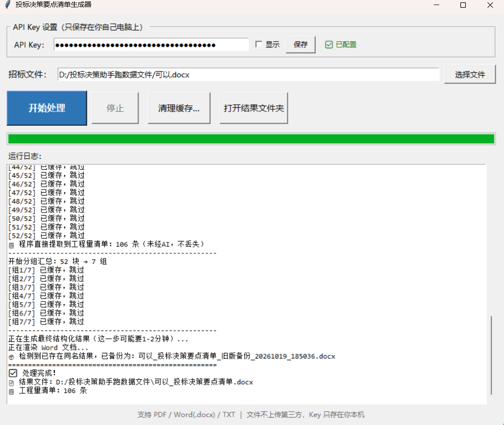
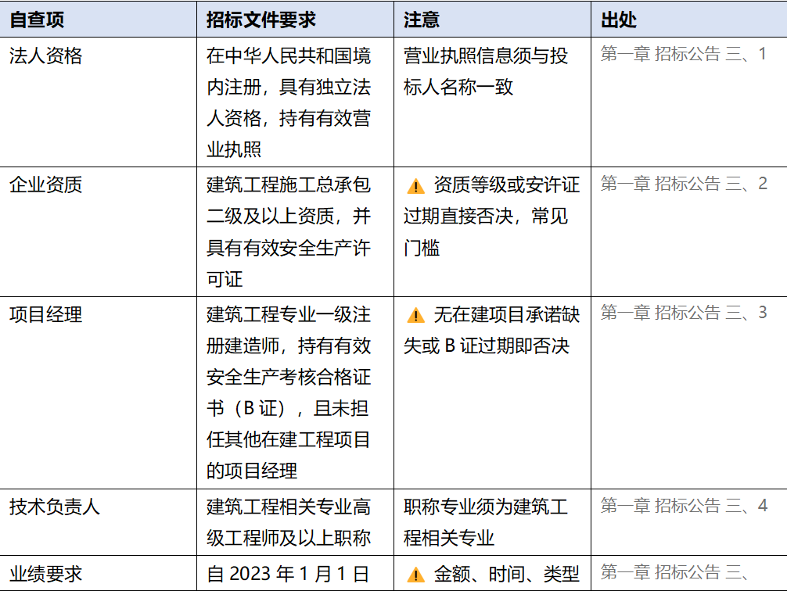

# 投标决策要点清单生成器

把一两百页的招标文件，变成一份**可逐条核对方**的《投标决策要点清单》。

输入 PDF / Word，输出带原文出处的 Word 报告 —— 资质门槛、投标截止、保证金、最高限价、
废标红线、评分办法……每条都标出处，不漏项。

> 落地场景：投标前漏掉一条废标条款，整份标书直接作废。人工翻一百页容易漏，机器不会。





---

## 效果示例

**输入**：`可以.docx`（约 15.2 万字，5810 个段落）

**输出**：一份 9 大类的 Word 报告。以下为真实输出节选：

| 类别 | 提取到的要点 | 注意 | 原文出处 |
|---|---|---|---|
| 资格门槛 | 具备建筑工程施工总承包二级及以上资质，并具有有效的安全生产许可证 | ⚠️ 资质等级不足或安许证过期直接否决 | 第一章 招标公告 三、投标人资格要求 2 |
| 资格门槛 | 近三年（2023—2025）财务状况良好，无亏损，须提供经审计的财务报告 | 财务状况不符合要求的，其投标将被否决 | 第一章 招标公告 三、投标人资格要求 6 |
| 关键时间 | 投标文件递交截止：2026年10月15日 9:30，逾期不予接收 | 同日 9:30 开标，有异议须当场提出 | 第一章 招标公告 五、投标文件的递交 1 |
| 费用现金流 | 最高投标限价 8600 万元；投标保证金 80 万元；履约保证金为合同价的 5%；预付款为合同价的 10% | ⚠️ 报价超限价即废标 | 投标人须知前附表 3.2.2、3.4.1、7.3.1 |
| 废标红线 | 投标报价不得超过最高投标限价，否则废标 | 共提取到 11 条废标条款，原文全部列明 | 第二卷 投标人须知前附表 3.2.3 |
| 怎么中标 | 综合评估法满分 100 分：商务标 60 + 技术标 30 + 信誉标 10；报价等于基准价得满分，每高于基准价 1% 扣 2 分 | 5 家及以下取算术平均值作基准价；6 家及以上去掉最高最低价 | 一、评标方法 1.2；4.1 商务标评分 |
| 工程量清单 | 共 106 条，如 `010101003` 挖基础土方 `m³` 52000 | 程序抓取、按编码去重，与原文逐项核对 | 直接从原文提取，未经汇总改写 |

**这份样本的可复核点**：源文件中共有 **106 个唯一清单项**，最终报告输出 **106 条**，零丢失。
（早期版本由模型全程搬运时，实测出现过 121 条被压缩到 31 条、外观正常且无任何报错的情况。）

---

## 功能特性

- **三种格式**：PDF / Word(.docx) / TXT
- **长文档自动切分**：分块提取 + 两级汇总，突破大模型上下文与输出长度双重限制
- **9 大类结构化输出**：资格门槛、关键时间节点、费用与现金流、废标红线、不予受理情形、
  评标办法、中标后风险条款、工程量清单、投标文件编制要求
- **每条标注原文出处**（如"投标人须知前附表 3.4.3"），可一键回查
- **生成带表格的 Word 报告**，可直接打印带进评标现场
- **图形界面**，处理中不卡顿，支持中途停止与断点续跑
- **数据不出本机**：除调用大模型接口外，文件不上传任何第三方

---

## 技术架构

```
招标文件（PDF / Word / TXT）
   │  读取（pypdf / python-docx，段落与表格都读）
纯文本
   │  按行切分（约 3000 字/块，以整行为单位，避免切断句子和表格）
文本块
   │  逐块调用大模型提取（带缓存、失败自检重试）
提取结果 ──┬── 工程量清单：代码按固定格式抓取 + 按编码去重（不进汇总）
   │       │
   │  分组汇总（8 块/组）→ 最终合并
结构化 JSON
   │  程序渲染（python-docx）
Word 报告
```

### 三个关键设计决策

**1. 分块提取 + 两级汇总**

大模型有上下文长度和输出长度双重限制。直接送长文档进去会丢信息；让它一次性吐出
全部内容的 JSON 会超出输出上限 —— 模型为保证 JSON 格式合法，会**主动删减内容**，
而且不报错。所以先切块提取，再分组汇总，最后合并。

**2. 让确定性数据绕开有损环节**

工程量清单是确定性数据：不需要模型"理解"，只需要原样搬运、去重、填表。但它在
"两轮汇总"这个有损环节里最容易被压缩。

做法：每块提取时要求模型按 `序号 | 项目编码 | 项目名称 | 单位 | 工程量` 固定格式
逐行输出；之后**清单不再进入任何汇总环节**，改由代码用正则从各块结果中抓取、
按项目编码去重，直接渲染进 Word。

> 早期版本由模型全程搬运清单，实测出现过 121 条被悄悄压缩到 31 条、外观完全正常、
> 无任何报错的情况 —— 静默失败是最危险的一类 bug，因为它看起来是对的。

**3. 工程健壮性**

- **缓存断点续跑**：每块结果落盘，中断后从断点继续，不必重跑百页文档
- **自检重试**：块内容较长却返回空结果时自动重试
- **两级降级**：缓存可用时优先读缓存，缓存不可用则现场分析兜底
- **文件占用处理**：结果文件正被 Word/WPS 打开时，自动备份改名，不丢用户批注
- **本地配置 + BYOK**：API Key 由用户自填，保存在 `%APPDATA%` 下，代码中无硬编码密钥

---

## 技术栈

`Python 3.10+` · `tkinter`（GUI）· `threading`（不阻塞主线程）·
`DeepSeek API`（deepseek-chat）· `pypdf`（PDF 解析）· `python-docx`（Word 生成）

---

## 快速开始

```bash
git clone https://github.com/Labixiaoxinye/bid-assistant.git
cd bid-assistant
pip install -r requirements.txt
```

### 图形界面版

```bash
python 投标软件.py
```

首次运行在界面里填入自己的 [DeepSeek API Key](https://platform.deepseek.com)，
之后自动保存在本地配置文件中。

### Agent 版（自然语言交互）

```bash
python agent_投标助手.py
```

示例提问：

```
帮我看看 D:\某项目招标文件.docx 能不能投
```

Agent 基于 Function Calling + ReAct 循环，会自主决定调用哪些工具
（读取招标文件、核验企业资质、测算利润空间），并给出有依据的结论。

**严谨性设计**：当缺少企业资质档案时，Agent 会明确告知"无法判断"，
不会用假设数据编出一个投标建议。

---

## 项目结构

```
bid-assistant/
├── 投标软件.py                        # 图形界面主程序
├── agent_投标助手.py                  # Agent 版（Function Calling + ReAct）
├── requirements.txt
├── docs/
│   └── screenshot.png                 # 界面截图
└── examples/
    └── company_profile.example.json   # 企业资质档案示例
```

---

## 局限与后续计划

**当前局限**

- 扫描版（图片型）PDF 无法提取文字，需先做 OCR
- 不解析 `.doc` 旧格式，需先另存为 `.docx`
- 提取结果依赖模型能力，**关键条款仍需人工以原文复核**；工具定位是"不漏项"，
  不是"替代人做判断"

**后续计划**

- [ ] 接入 OCR，支持扫描件
- [ ] 清单提取同时扫描原文，与各块结果取并集，进一步降低漏项风险
- [ ] 输出增加"风险等级"维度，便于快速筛查
- [ ] 建立历史标书信息库，支持跨项目对比与报价参考

---

## 说明

- AI 生成内容仅供参考，关键信息请以招标文件原文核对
- 本项目用于技术交流，实际投标决策请以专业判断为准

## License

MIT

## 作者

独立开发者 · 工程造价专业 · 关注 AI 在工程领域的落地应用
